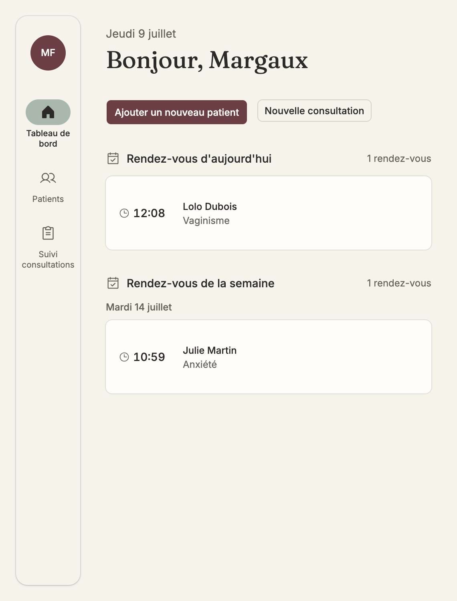
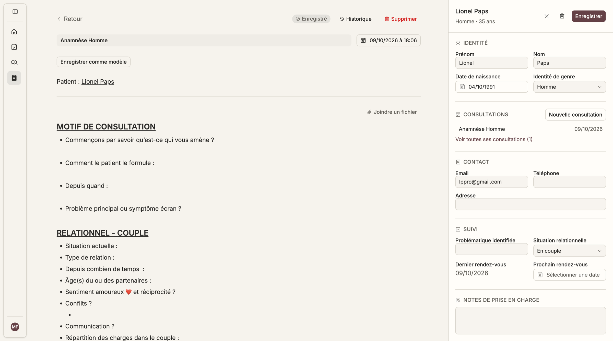

# Vela

**Suivi patient pour les praticiens de l'accompagnement** — psychologues, sexologues, hypnothérapeutes, coachs, sophrologues, naturopathes.

[▶ Essayer la démo (sans compte)](https://velaconsult.vercel.app/demo) · [Brand book](docs/brand/vela-brand-book.md) · [Étude de cas sur mon portfolio](https://gaumsportfolio.vercel.app)



## Le problème

Les praticiens indépendants gèrent des données de santé très sensibles avec des outils qui ne sont pas faits pour ça : carnets papier, Google Docs, tableurs. Les logiciels médicaux existants sont pensés pour des médecins, sont chargés et anxiogènes. Vela leur offre un espace sobre et rassurant, avec le niveau d'exigence que demandent des données patients (RGPD/HDS).

## Ce que j'ai fait

Projet freelance, de la discovery à la mise en production.

- **Design** : identité de marque, design system sur tokens (Tailwind v4 + shadcn/ui), parcours d'onboarding, fiches patient, modèles de consultation, historique de versions.
- **Développement** : application full-stack Next.js (App Router) en TypeScript strict, PostgreSQL sans ORM, migrations SQL versionnées, emails transactionnels.
- **Qualité** : tests unitaires et tests d'intégration des routes API sur une vraie base Postgres, CI GitHub Actions sur chaque PR, travail par pull requests.



## Décisions techniques

| Décision | Pourquoi |
|---|---|
| SQL paramétré, sans ORM | Contrôle total sur chaque requête qui touche des données de santé |
| Toutes les requêtes scopées par `practitioner_id` | Un praticien ne peut jamais lire les patients d'un autre, et c'est vérifié par les tests d'intégration |
| Tests d'intégration sur un Postgres réel (Docker) | Les erreurs de schéma et de migration remontent en CI, pas en production |
| Rendu serveur privilégié, pas d'animation décorative | Sobriété et performance, cohérentes avec la marque |

## Stack technique

- [Next.js](https://nextjs.org/) (App Router)
- TypeScript (mode strict)
- PostgreSQL (via `pg`, sans ORM)
- Serveur HDS (non configuré)
- NextAuth (authentification par credentials)
- Tailwind CSS v4 + shadcn/ui
- Resend (envoi d'emails transactionnels)

## Prérequis

- Node.js
- Une base de données PostgreSQL accessible localement (ex. via Docker)

## Installation

```bash
npm install
```

Copie `.env.example` en `.env.local` et renseigne les valeurs :

```bash
cp .env.example .env.local
```

| Variable | Description |
|---|---|
| `DATABASE_URL` | Chaîne de connexion PostgreSQL |
| `NEXTAUTH_SECRET` | Secret utilisé par NextAuth pour signer les sessions JWT |
| `NEXTAUTH_URL` | URL de base de l'application (ex. `http://localhost:3001`) |
| `RESEND_API_KEY` | Clé API Resend pour l'envoi d'emails |
| `RESEND_FROM_EMAIL` | Adresse d'expédition des emails transactionnels |
| `SUPPORT_EMAIL` | Adresse de contact affichée aux utilisateurs |

Ne commite jamais `.env.local`.

Initialise le schéma de base de données en exécutant [`src/lib/schema.sql`](src/lib/schema.sql) puis les migrations dans [`src/lib/migrations/`](src/lib/migrations) (par ordre numérique) sur ta base PostgreSQL.

## Commandes

```bash
npm run dev     # démarre le serveur de développement
npm run build   # build de production
npm run start   # démarre le serveur en mode production
npm run lint    # vérifie le code avec ESLint
```

## Architecture

- **Routage** : `src/app` (App Router), pages serveur et client mélangées selon les besoins d'interactivité.
- **Authentification** : NextAuth (`src/lib/auth.ts`), provider Credentials, hashage bcrypt, sessions JWT.
- **Accès aux données** : PostgreSQL via `pg` (`src/lib/db.ts`), requêtes SQL directes, schéma dans `src/lib/schema.sql`.
- **API** : routes sous `src/app/api` (authentification, patients, consultations, gabarits de consultation, compte praticien, pièces jointes).
- **Design system** : Tailwind CSS v4 (tokens dans `src/app/globals.css`), composants réutilisables sous `src/components/ui`.

Documentation détaillée dans le dossier [`claude/`](claude) :

- [`claude/architecture.md`](claude/architecture.md)
- [`claude/coding_conventions.md`](claude/coding_conventions.md)
- [`claude/ui_guidelines.md`](claude/ui_guidelines.md)

## Structure du projet

```
vela/
 ├── claude/                # Documentation détaillée du projet
 ├── src/
 │   ├── app/                # Routes (App Router) : pages, layouts, API
 │   │   ├── (dashboard)/    # Espace praticien : patients, consultations, compte
 │   │   ├── (onboarding)/   # Parcours d'onboarding praticien
 │   │   ├── api/            # Routes API
 │   │   └── login/          # Page de connexion / inscription
 │   ├── components/
 │   │   └── ui/             # Composants UI réutilisables (shadcn/ui)
 │   ├── lib/                # Logique serveur : auth, DB, schéma SQL, migrations
 │   └── types/               # Déclarations de types partagées
 ├── tests/integration/       # Tests API contre un vrai Postgres
 ├── docs/
 │   ├── brand/               # Brand book + moodboard
 │   └── screenshots/         # Captures d'écran
 └── public/                  # Assets statiques
```

## Points d'attention

- **RGPD/HDS** : les données patients sont sensibles ; toute requête doit être scopée par praticien (`practitioner_id`) et paramétrée (pas de concaténation SQL brute).
- **Accessibilité** : contrastes suffisants, labels explicites sur les formulaires, navigation clavier fonctionnelle.
- **Performance** : pas d'animation décorative, rendu serveur privilégié.
- **Tests** : Vitest (unitaire + intégration API contre Postgres), CI GitHub Actions sur chaque push/PR — voir [`claude/testing_strategy.md`](claude/testing_strategy.md).
